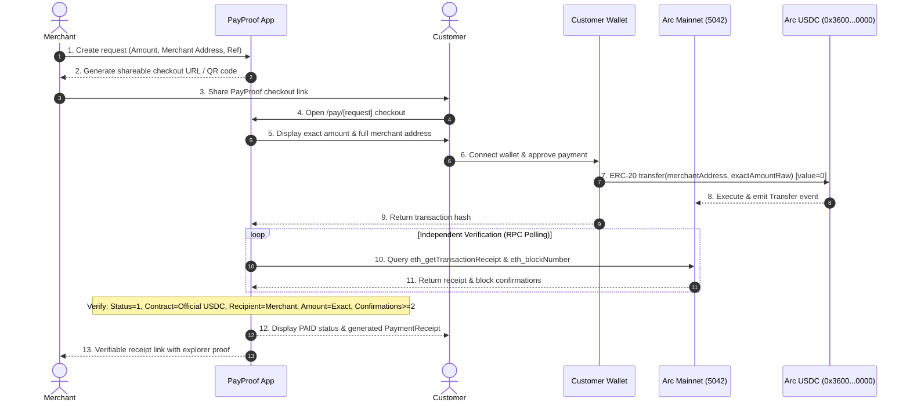

# PayProof

[](https://explorer.arc.io)
[](https://explorer.arc.io/token/0x3600000000000000000000000000000000000000)
[](https://nextjs.org)
[](https://www.typescriptlang.org)
[](https://github.com/JimmyOgb/PayProof)
[](LICENSE)

> **Non-custodial USDC payment checkout and verification on Arc Mainnet.**  
> Customers pay directly wallet-to-wallet. PayProof independently verifies the transaction on-chain and generates an immutable, tamper-evident receipt.

* **GitHub Repository**: [https://github.com/JimmyOgb/PayProof](https://github.com/JimmyOgb/PayProof)
* **Current Production Deployment**: [https://payproof-puce.vercel.app](https://payproof-puce.vercel.app)
* **Target Blockchain**: **Arc Mainnet** (Chain ID: `5042`)

---

## What is PayProof?

PayProof is an Arc-native payment rail designed for merchants and creators. It allows merchants to create lightweight, stateless checkout links and invoices for exact USDC amounts. Customers settle payments directly from their self-custody EVM wallets (such as MetaMask, Rabby, Coinbase Wallet) on Arc Mainnet.

Once broadcast, PayProof’s client-side verification engine independently queries Arc Mainnet JSON-RPC nodes to audit the transaction execution, verify the official Circle USDC contract log, validate the exact recipient and base-unit amount, and confirm finality depth. Only when all deterministic blockchain proofs are satisfied does the state transition to `PAID`.

---

## The Problem

Accepting cryptocurrency payments today places an unreasonable operational burden on merchants:
1. **Screenshot Fraud**: Customers send manipulated transaction confirmation screenshots or forged receipts.
2. **Manual Explorer Auditing**: Merchants must navigate block explorers, search hex hashes, inspect transaction logs, decipher token contract addresses, and calculate decimal units to verify payments.
3. **Custodial Escrows & High Fees**: Existing Web3 checkout gateways act as custodial intermediaries, withholding merchant funds, charging 1% to 3% processing fees, and creating third-party regulatory risks.
4. **Volatile Gas & Volatile Tokens**: Transactions on traditional L1s suffer from volatile gas tokens and unpredictable settlement times.

---

## The Solution

PayProof provides an intuitive, non-custodial checkout flow built specifically for **Arc Mainnet**:
* **Dual-Track Settlement**: PayProof supports both **Smart Contract Settlement** via [`PayProofPayments.sol`](file:///C:/Users/NO%20GO%20NO/payproof/contracts/PayProofPayments.sol) (emitting canonical `PaymentCompleted` events with cryptographic parameters) and direct peer-to-peer ERC-20 transfers. Funds always route directly to the merchant wallet with zero custody.
* **Independent Verification**: PayProof queries Arc Mainnet directly via JSON-RPC. A payment is only marked `PAID` after verifying on-chain execution, contract address, recipient address, exact 6-decimal base units, and `PaymentCompleted` or `Transfer` logs.
* **Instant, Verifiable Proof**: Upon confirmation, an immutable `PaymentReceipt` is generated that anyone can verify on Arc Mainnet.
* **Stateless Portability**: The core payment request parameters are serialized into compact, tamper-evident Base64URL links with deterministic integrity checksums.

---

## How It Works



---

## Why Arc?

PayProof is built specifically for **Arc Mainnet**, leveraging Circle’s purpose-built Layer 1 architecture:

* **USDC as Native Gas**: Arc uses USDC at the protocol layer (`weiUSDC`, 18 decimals) for transaction fees, eliminating the need for merchants or customers to acquire volatile tokens like ETH, SOL, or MATIC just to pay gas.
* **Official Predeployed USDC ERC-20 Contract**: Arc features the official canonical USDC ERC-20 contract interface predeployed at `0x3600000000000000000000000000000000000000` with standard 6-decimal commerce precision.
* **Sub-Second Finality**: Powered by Malachite BFT consensus, Arc achieves fast block times (~0.5s), enabling near-instant retail checkouts without waiting minutes for multi-block confirmations.
* **Predictable, Micro-Cent Transaction Costs**: Low, predictable execution fees ensure micro-payments and small commerce invoices remain economical.

---

## Verified Arc Mainnet Configuration

All parameters below are active and verified in the codebase (`frontend/lib/arc/config.ts` and `frontend/lib/arc/chain.ts`):

| Parameter | Value | Details |
|---|---|---|
| **Network Name** | `Arc Mainnet` | Official Layer 1 network |
| **Chain ID** | `5042` | Official Arc Mainnet chain ID |
| **JSON-RPC Endpoint** | `https://rpc.mainnet.arc.io` | Verified production RPC |
| **Block Explorer** | `https://explorer.arc.io` | Official block explorer |
| **Official USDC Predeploy** | `0x3600000000000000000000000000000000000000` | Canonical Circle USDC contract |
| **USDC Precision** | `6 decimals` | Standard USDC units ($1.00 = 1,000,000 base units) |
| **Native Protocol Gas** | `USDC` (`weiUSDC`, 18 decimals) | Protocol gas accounting |
| **Required Confirmations** | `2 blocks` | Verified on-chain finality depth |

---

## Security by Design

PayProof enforces a strict, defense-in-depth security model across the entire payment pipeline.

### Direct ERC-20 Transfer Only
The customer wallet transaction is restricted to a standard ERC-20 `transfer`:
```solidity
USDC.transfer(address recipient, uint256 amount)
```
With explicit native value enforcement:
```typescript
value: 0n // Zero native asset transferred
```

### Prohibited Operations
PayProof **never** executes, requests, or prompts for:
* `approve` (token allowances)
* `permit` or `Permit2` off-chain signatures
* `setApprovalForAll` (NFT or operator access)
* Router or liquidity aggregator contracts
* Multi-call or batch transactions
* Arbitrary calldata or proxy execution
* Native gas asset transfers (`value > 0`)

### Complete Address Transparency
To prevent clipboard replacement and address-poisoning attacks:
* The checkout UI displays the **full, un-truncated merchant recipient address** in monospace font.
* A one-click copy button allows the customer to verify character-by-character against their invoice.
* Clear disclosures state: *"Your wallet will send exactly X USDC directly to the merchant address above. PayProof does not receive or custody your funds."*

### Integrity Checksum vs. Digital Signatures
The payment request token includes an integrity checksum generated via canonical Keccak-256 (`computePaymentRequestHash`).  
> **Technical Note**: In PayProof V1, this hash serves as an **integrity checksum** against URL truncation or accidental corruption. Because PayProof is stateless and does not custody merchant private keys, this hash is **not** an asymmetric digital signature. As part of our roadmap, merchant-signed payment requests (EIP-712) will be introduced for cryptographic origin verification.

---

## On-Chain Payment Verification Engine

PayProof **fails closed**: a payment cannot transition from `SUBMITTED` to `PAID` without passing an exhaustive 10-point deterministic blockchain audit in `verifyPaymentOnChain` (`frontend/lib/payments/verifier.ts`):

1. **Format Check**: Transaction hash is a valid 32-byte hex string (`0x...`).
2. **Transaction Inclusion**: `eth_getTransaction` confirms transaction existence on Arc.
3. **Chain ID Alignment**: Verified transaction chain ID matches `5042`.
4. **Receipt Status**: `eth_getTransactionReceipt` returns execution `status: 1` (`success`). A reverted transaction immediately transitions to `FAILED`.
5. **Event Log Extraction**: Transaction logs are parsed for standard ERC-20 `Transfer(address,address,uint256)` topics.
6. **Contract Origin Verification**: The emitted `Transfer` event address must strictly equal `0x3600000000000000000000000000000000000000` (official Arc USDC predeploy).
7. **Exact Recipient Match**: The `Transfer` event recipient (`to`) must match the payment request merchant address.
8. **Exact Amount Match**: The `Transfer` event amount (`value`) must match the requested amount in base units (exact integer comparison, no floating-point math).
9. **Sender Verification**: If expected sender is specified, the event sender (`from`) must match the paying wallet address.
10. **Finality Depth**: Current block height minus receipt block height must satisfy the required confirmation threshold ($\ge 2$ blocks).

---

## Product Features (Implemented in V1)

* **Stateless Payment Request Generator** (`/create`): Create portable payment requests specifying amount, merchant address, order reference, description, and expiration.
* **Portable Checkout Links & QR Codes**: Shareable Base64URL links and downloadable QR codes for mobile and in-person POS checkouts.
* **Arc-Native Wallet Connection**: Integrated Wagmi/Viem connector targeting Arc Mainnet (`5042`) with automatic chain-switching prompts.
* **Direct Non-Custodial USDC Checkout** (`/pay/[request]`): Full recipient transparency, automatic base-unit conversion, and explicit transaction signing.
* **Independent On-Chain Verifier**: Client-side RPC verification loop auditing block confirmations and event logs.
* **Tamper-Evident Receipts** (`/receipt/[data]`): Shareable receipt pages with transaction hash, block height, confirmation count, and direct Arc Explorer links.
* **Re-Verification on Load**: Receipts independently re-query Arc Mainnet on every page load rather than trusting cached states.
* **SSR/Hydration Guard**: Deterministic multi-stage mounting ensures zero SSR hydration mismatches across server and client.

---

## Architecture

```
PayProof System Architecture
┌─────────────────────────────────────────────────────────────────┐
│                        Merchant Workflow                        │
│  1. Connect Wallet -> Input Amount & Metadata                   │
│  2. Generate Stateless URL Token (Base64URL)                    │
└────────────────────────────────┬────────────────────────────────┘
                                 │
                                 ▼
┌─────────────────────────────────────────────────────────────────┐
│                        Customer Checkout                        │
│  3. Open /pay/[request] -> Validate Request & Check Expiration  │
│  4. Connect Wallet (Arc Mainnet: 5042)                          │
│  5. Send direct USDC transfer(merchant, amount)                 │
└────────────────────────────────┬────────────────────────────────┘
                                 │
                                 ▼
┌─────────────────────────────────────────────────────────────────┐
│                       Settlement & Proof                        │
│  6. Arc Mainnet USDC Contract (0x3600...0000)                   │
│     Customer Wallet ──────(Direct Transfer)─────> Merchant     │
│  7. PayProof Client verifies Transfer Log & Confirmations       │
│  8. Immutable Payment Receipt generated (/receipt/[data])       │
└─────────────────────────────────────────────────────────────────┘
```

---

## Technology Stack

* **Framework**: [Next.js 15.1.7](https://nextjs.org) (App Router, React 19)
* **Language**: [TypeScript 5.7.3](https://www.typescriptlang.org) (Strict typechecking)
* **Blockchain Layer**: [viem 2.23.5](https://viem.sh) & [wagmi 2.14.16](https://wagmi.sh)
* **State & Query Management**: [@tanstack/react-query 5.66.0](https://tanstack.com/query)
* **Styling**: [Tailwind CSS 3.4.17](https://tailwindcss.com) & custom design system
* **Icons**: [Lucide React 1.16.0](https://lucide.dev)
* **Testing Suite**: [Vitest 3.0.5](https://vitest.dev)

---

## Project Structure

```
payproof/
├── README.md                      # Project documentation and specifications
├── package.json                   # Root package configuration
├── scripts/
│   └── smoke-test-arc.mjs         # Live read-only Arc Mainnet RPC smoke test
├── docs/
│   ├── arc-mainnet.md             # Arc Mainnet parameters and architecture
│   ├── architecture.md            # Detailed system design
│   ├── payment-flow.md            # Payment lifecycle and state machine
│   └── deployment.md              # Deployment guide
└── frontend/                      # Standalone Next.js application
    ├── package.json               # Frontend dependencies and scripts
    ├── next.config.ts             # Next.js configuration
    ├── tsconfig.json              # TypeScript strict configuration
    ├── app/                       # Next.js App Router
    │   ├── layout.tsx             # Root layout with Wagmi & Query providers
    │   ├── page.tsx               # PayProof landing page
    │   ├── create/page.tsx        # Merchant payment link generator
    │   ├── pay/[request]/page.tsx # Customer checkout interface
    │   └── receipt/[data]/page.tsx# Verified payment receipt view
    ├── components/                # React UI components
    │   ├── PaymentCheckout.tsx    # Core checkout component
    │   ├── CreatePayment.tsx      # Payment request generator form
    │   ├── PaymentReceipt.tsx     # On-chain verified receipt component
    │   ├── PaymentQRCode.tsx      # QR code generator
    │   ├── WalletConnect.tsx      # Arc network wallet connection
    │   └── Navbar.tsx / Footer.tsx# Navigation and brand layout
    ├── lib/                       # Core business and blockchain logic
    │   ├── arc/                   # Arc chain definition and configuration
    │   │   ├── chain.ts           # Viem Arc Mainnet chain definition
    │   │   └── config.ts          # Centralized Arc parameters & RPC config
    │   ├── payments/              # Payment protocol and verification engine
    │   │   ├── verifier.ts        # 10-point on-chain transaction verifier
    │   │   ├── transfer.ts        # Direct ERC-20 transfer caller
    │   │   ├── request.ts         # Payment request creation & hashing
    │   │   ├── encoding.ts        # Base64URL wire serialization
    │   │   ├── validation.ts      # Defense-in-depth request validation
    │   │   ├── receipt.ts         # Immutable receipt builder
    │   │   ├── stateMachine.ts    # Deterministic payment state transitions
    │   │   ├── units.ts           # Exact 6-decimal bigint math utilities
    │   │   └── useUSDCPayment.ts  # Orchestration React hook
    │   └── wallet/                # Wagmi client configuration
    └── tests/                     # Vitest automated test suite
        ├── verifier.test.ts       # 19 tests: On-chain verifier & fail-closed logic
        ├── request-encoding.test.ts# 13 tests: Token encoding/decoding roundtrips
        ├── hydration.test.tsx     # 9 tests: SSR hydration & mounting checks
        ├── units.test.ts          # 8 tests: Bigint conversion and decimal parsing
        ├── stateMachine.test.ts   # 6 tests: Strict payment status transitions
        ├── arc-config.test.ts     # 5 tests: Arc mainnet configuration invariants
        ├── receipt.test.ts        # 3 tests: Receipt generation & validation
        └── payments.test.ts       # 2 tests: Payment flow integration tests
```

---

## Getting Started

### Prerequisites
* Node.js $\ge 18.18.0$ (Node.js 20+ recommended)
* npm $\ge 9.0.0$

### Local Installation
```bash
# 1. Clone the repository
git clone https://github.com/JimmyOgb/PayProof.git
cd PayProof

# 2. Install dependencies
npm install

# 3. Configure environment variables
cp frontend/.env.example frontend/.env.local

# 4. Start the development server
npm run dev
```
Open [http://localhost:3000](http://localhost:3000) in your browser.

---

## Environment Configuration

The application requires no private keys or secrets. Configured variables (`frontend/.env.local`):

```bash
# Application
NEXT_PUBLIC_APP_NAME="PayProof"
NEXT_PUBLIC_APP_URL="http://localhost:3000"

# Arc Mainnet (5042)
NEXT_PUBLIC_ARC_CHAIN_ID=5042
NEXT_PUBLIC_ARC_RPC_URL="https://rpc.mainnet.arc.io"
NEXT_PUBLIC_ARC_EXPLORER_URL="https://explorer.arc.io"
NEXT_PUBLIC_ARC_USDC_ADDRESS="0x3600000000000000000000000000000000000000"

# Optional dedicated private RPC endpoint for high-throughput production
ARC_RPC_FALLBACK_URL=""
```

---

## Testing & Quality Verification

PayProof enforces automated testing, typechecking, and static analysis:

```bash
# Compile contracts with Solc 0.8.28
npm run compile

# Run complete test suite (85 tests across 10 test suites)
npm test

# Run read-only Arc Mainnet live smoke test (zero funds spent)
npm run test:smoke

# Run TypeScript strict typecheck
npm run typecheck

# Run ESLint check
npm run lint

# Build production bundle
npm run build
```

### Current Verified Test Suite Status:
```text
 ✓ tests/approval-security.test.ts (12 tests)
 ✓ tests/verifier.test.ts (19 tests)
 ✓ tests/contract-verifier.test.ts (8 tests)
 ✓ tests/request-encoding.test.ts (13 tests)
 ✓ tests/hydration.test.tsx (9 tests)
 ✓ tests/units.test.ts (8 tests)
 ✓ tests/stateMachine.test.ts (6 tests)
 ✓ tests/arc-config.test.ts (5 tests)
 ✓ tests/receipt.test.ts (3 tests)
 ✓ tests/payments.test.ts (2 tests)

Test Files:  10 passed (10)
Tests:       85 passed (85)
Contract:    18/18 on-chain formal requirements verified in Solidity test suite
TypeScript:  0 errors (tsc --noEmit clean)
ESLint:      0 errors, 0 warnings
Build:       Clean static and dynamic page generation
```

---

## Production Deployment & Status

* **Public Production Deployment**: [https://payproof-puce.vercel.app](https://payproof-puce.vercel.app)
* **Vercel Project**: `payproof` (`jamism123/payproof`)
* **Deployment Target**: Production (Arc Mainnet Chain ID: `5042`)
* **PayProofPayments Contract**: [`0x87d4a1669336882e3355b83f953ad3b8b944c908`](https://explorer.arc.io/address/0x87d4a1669336882e3355b83f953ad3b8b944c908)
* **Contract Deployment Tx**: [`0x47012ff7ac41ea8ab8f12fcaf1ac28958015c8f0010466a1f2049ebcead308f6`](https://explorer.arc.io/tx/0x47012ff7ac41ea8ab8f12fcaf1ac28958015c8f0010466a1f2049ebcead308f6)
* **Official Arc USDC**: `0x3600000000000000000000000000000000000000`

### Domain Reputation Notice
> **Notice on Current Deployment**: The current deployment on `*.vercel.app` is an ephemeral project domain. Automated wallet security providers (Blockaid / Coinbase Wallet / MetaMask) apply zero-trust heuristics to newly created `*.vercel.app` subdomains prompting Web3 wallet connections.  
> The transaction code has been audited: **it is strictly a direct USDC ERC-20 transfer with value = 0**. While we submit whitelist requests and prepare custom domain routing, real-money mainnet payment demos should be verified on local environments or reviewed directly against the open-source code.

---

## Try PayProof

1. **Visit the Deployment**: Navigate to [https://payproof-puce.vercel.app/create](https://payproof-puce.vercel.app/create) (or run locally at `http://localhost:3000/create`).
2. **Create Payment Request**: Enter an amount (e.g. `25.00` USDC), enter a recipient EVM address, and click **Create Payment Link**.
3. **Open Checkout**: Copy the generated link or scan the QR code to open `/pay/[request]`.
4. **Inspect Transaction Safety**: Notice the full merchant address display and non-custodial transfer notice.
5. **Verify Receipts**: Explore verified receipts at `/receipt/[data]` to observe independent RPC re-verification.

---

## Future Roadmap

* **EIP-712 Merchant Signatures**: Cryptographically sign payment requests using the merchant's wallet to provide asymmetric authenticity guarantees.
* **Embeddable PayProof Buttons**: Lightweight JavaScript SDK for merchants to embed "Pay with USDC on Arc" buttons on Shopify, WooCommerce, and custom storefronts.
* **Webhook & Agent Infrastructure**: Optional serverless webhook listeners for automated order fulfillment and AI agent-to-merchant micro-settlements.
* **Batch Invoicing & Accounting**: CSV export and multi-invoice settlement views for bookkeeping and financial reporting.

---

## Why PayProof Matters for the Arc Ecosystem

PayProof demonstrates the practical power of Arc as a settlement layer for everyday digital commerce. Rather than treating stablecoins as speculative instruments, PayProof treats USDC on Arc as cash:
1. **No Gas Friction**: Users pay fees in the same token they use for purchases.
2. **True Non-Custodial Security**: Merchants receive payments directly in their wallets without counterparty risk.
3. **Open & Auditable**: Every payment has cryptographic and on-chain proof that anyone can inspect.

---

## License

This project is licensed under the [MIT License](LICENSE).
