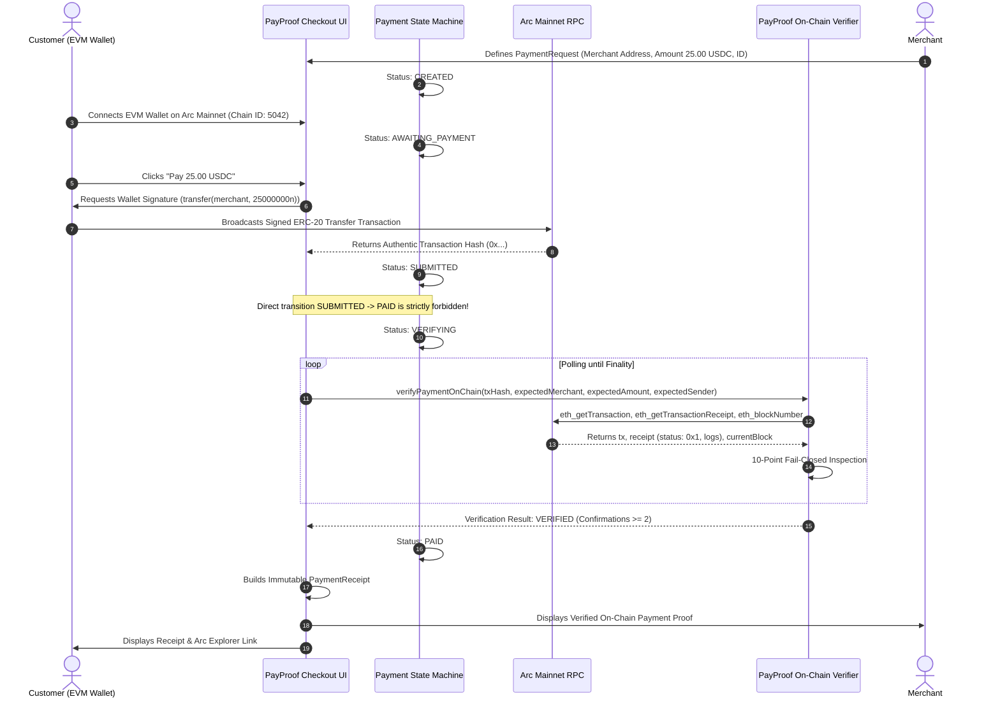

# PayProof Payment Settlement Lifecycle & Architecture

## Overview

PayProof is a real, non-custodial USDC payment flow operating on **Arc Mainnet** (Chain ID: `5042`).

Unlike traditional web payment processors or custodial crypto gateways:
- Funds travel directly from the customer's self-custodial wallet to the merchant's wallet.
- PayProof never holds private keys, routes funds through escrow, or takes custody.
- A payment request is only marked as `PAID` after independent, on-chain verification of the Arc transaction receipt and ERC-20 `Transfer` event log.
- Zero mock blockchain data is used.

---

## Complete Payment Lifecycle



---

## Payment Lifecycle State Machine

```
CREATED
  │
  ▼
AWAITING_PAYMENT ──[User Signs Tx]──► SUBMITTED
                                         │
                                         ▼
                                     VERIFYING ──[Verification Fails]──► FAILED
                                         │                                  │
                             [Independent On-Chain                          │ (Retry)
                               Verification Passes]                         ▼
                                         │                          AWAITING_PAYMENT
                                         ▼
                                       PAID
```

### State Definitions

1. `CREATED`: Payment request defined with verified parameters (merchant address, exact base unit amount, chain ID 5042).
2. `AWAITING_PAYMENT`: Customer wallet is connected to Arc Mainnet; ready for user action.
3. `SUBMITTED`: Customer has signed and broadcast the transfer transaction to Arc. Wallet has returned an authentic `txHash`.
4. `VERIFYING`: PayProof is independently polling Arc RPC to query the transaction receipt, decode event logs, and verify block confirmations.
5. `PAID`: Terminal success state. The transaction has satisfied all 10 independent verification rules on Arc Mainnet.
6. `FAILED`: Transaction reverted, rejected, timed out, or failed any verification check. The user may retry.
7. `EXPIRED`: Payment request exceeded the validity window before completion.
8. `INVALID`: Malformed payment request parameters.

> **CRITICAL INVARIANT:**
> The state machine strictly prohibits transitioning directly from `SUBMITTED` to `PAID`. A transaction hash provided by a wallet UI is merely a submission claim; only independent on-chain verification transitions the state to `PAID`.

---

## Protocol Specifications

### 1. Custody Model
* **100% Non-Custodial**: Payments are direct peer-to-peer ERC-20 transfers between the customer and merchant wallets.
* **No Middleman / Escrow**: PayProof does not route payments through an intermediary smart contract, relayer, or custodial bank account.
* **Zero Private Key Exposure**: Neither PayProof nor any server-side process handles customer or merchant private keys.

### 2. Verified Asset & Decimal Precision
* **Asset**: USD Coin (`USDC`) on Arc Mainnet.
* **Smart Contract**: Predeployed official USDC contract at `0x3600000000000000000000000000000000000000`.
* **Decimal Representation**: The ERC-20 contract operates with **6 decimals** (`1 USDC = 1,000,000` base units).
* **Exact Integer Arithmetic**: All amounts are represented and calculated using `bigint` base units. Floating-point arithmetic (`number`) is strictly forbidden for financial balances and on-chain values.

### 3. Consensus & Finality
* **Consensus**: Arc utilizes the **Malachite BFT** consensus engine with ~0.5 second block times. Once a block is committed by two-thirds of the validator set, it achieves deterministic finality without chain reorganizations.
* **Confirmation Threshold**: PayProof enforces a minimum confirmation count (default: $\ge 2$ block confirmations, $\approx 1$ second) to protect against RPC node lag and transient network partitions.

---

## 10-Point Independent On-Chain Verification Rules

The verifier executes the following 10 checks against Arc RPC data:

1. **Transaction Exists**: The transaction must be successfully fetched from Arc RPC via `eth_getTransaction`.
2. **Chain ID Verification**: The transaction chain ID must match Arc Mainnet (`5042`).
3. **Execution Success**: The transaction receipt status must be strictly `success` (`0x1`), confirming no EVM revert occurred.
4. **Log Extraction**: The receipt must contain valid decoded event logs.
5. **Contract Origin**: The event log must be emitted by the official predeployed USDC contract `0x3600000000000000000000000000000000000000`.
6. **Recipient Integrity**: The `Transfer(from, to, value)` `to` argument must match the merchant's designated wallet address byte-for-byte (case-insensitive checksum comparison).
7. **Amount Exactness**: The `Transfer` `value` must equal the exact requested integer amount in 6-decimal base units (`bigint`).
8. **Sender Match**: When the expected payer address is known, the `from` argument must match the customer's connected wallet address.
9. **Finality & Confirmations**: The transaction block must have achieved the required confirmation depth:
   $$\text{currentBlock} - \text{txBlock} + 1 \ge \text{requiredConfirmations}$$
10. **Field Consistency**: All cryptographic hashes, block numbers, and addresses must be internally consistent.

### Fail-Closed Principle
If any check cannot be conclusively proven from RPC data, verification returns `FAILED` or `PENDING`. PayProof never assumes success.

---

## Security Assumptions & Threat Model

* **Untrusted Client State**: Client-side localStorage, URL parameters, wallet extension popups, and user-provided inputs are treated as untrusted.
* **Source of Truth**: The Arc blockchain JSON-RPC node is the sole authority for transaction execution, balances, and event logs.
* **Decimals Trap Mitigation**: The distinction between Arc native gas (18 decimals) and ERC-20 USDC (6 decimals) is strictly enforced in code to prevent factor-$10^{12}$ accounting errors.
